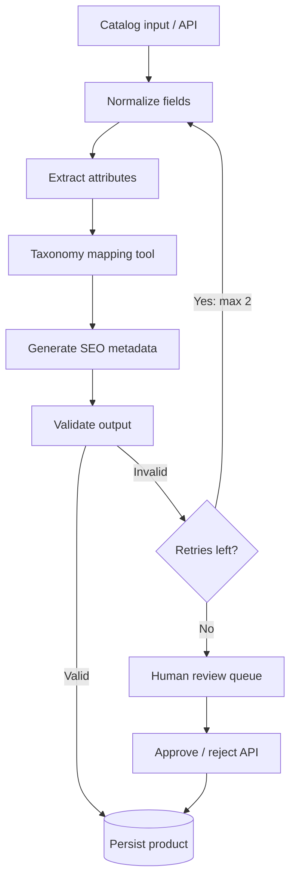

# AI-Powered Catalog Enrichment Pipeline

A runnable MVP that turns messy product records into normalized, categorized, attribute-rich catalog entries with SEO metadata and a human-review path.

## Architecture



### Components
- **FastAPI** exposes health, single-item, batch, product lookup, and review endpoints.
- **Pydantic** validates incoming and outgoing data contracts.
- **Pipeline** separates normalization, extraction, taxonomy, SEO generation, and validation into small services.
- **Mock LLM provider** creates deterministic SEO text without credentials. `app/services/llm.py` is the provider seam for a real model later.
- **SQLite** is the zero-setup local database. Set `DATABASE_URL` to a PostgreSQL SQLAlchemy URL for deployment.
- **MCP adapter** exposes taxonomy and validation tools via FastMCP (optional dependency).

> This is a one-day MVP scaffold. LangGraph/LangChain orchestration and a production LLM provider are intentionally left as extension points rather than pretending the starter already uses them. The current workflow is plain Python so it runs reliably without API keys.

## Run locally

```bash
python -m venv .venv
# Windows: .venv\Scripts\activate
# macOS/Linux: source .venv/bin/activate
pip install -r requirements.txt
cp .env.example .env   # Windows PowerShell: Copy-Item .env.example .env
uvicorn app.main:app --reload
```

Open http://127.0.0.1:8000/docs. No paid API key required.

## Example request

```bash
curl -X POST http://127.0.0.1:8000/api/v1/enrich \
  -H "Content-Type: application/json" \
  -d '{"sku":"PET-101","title":"Large blue dog leash","description":"Durable nylon leash","brand":"PawCo"}'
```

Try `POST /api/v1/enrich/batch`, `GET /api/v1/products`, `GET /api/v1/products/PET-101`, and `POST /api/v1/products/PET-101/review` in Swagger UI.

## Tests

```bash
pip install httpx
pytest -q
```

## Docker

```bash
cp .env.example .env
docker compose up --build
```

## Free deployment path

1. Push this folder to a GitHub repository.
2. Create a **Neon** PostgreSQL database and copy its connection string. Use a SQLAlchemy-compatible URL such as `postgresql+psycopg://...` and add `psycopg[binary]` to requirements if using that driver (or use `postgresql://...` with `psycopg2-binary`).
3. Create a **Render Web Service** from the repository. Build command: `pip install -r requirements.txt`; start command: `uvicorn app.main:app --host 0.0.0.0 --port $PORT`.
4. Add `DATABASE_URL` and `LLM_MODE=mock` in Render environment variables.
5. Check `/health` and `/docs` after deploy.

Free hosting availability/limits can change. Render free web services may sleep when idle; local filesystem storage on ephemeral hosts is not durable, so use Neon rather than SQLite in production. Keep secrets in environment variables, never commit `.env`.

## Next improvements

- Replace the mock provider with an LLM provider and structured JSON output.
- Add true LangGraph nodes/state, conditional retry edges, and checkpointing.
- Add category-specific schemas, confidence scores, deduplication, and bulk CSV ingestion.
- Add Redis + Celery for background batch jobs, idempotency keys, and a durable review queue.
- Add auth, rate limits, observability, migrations (Alembic), and integration tests before production use.
