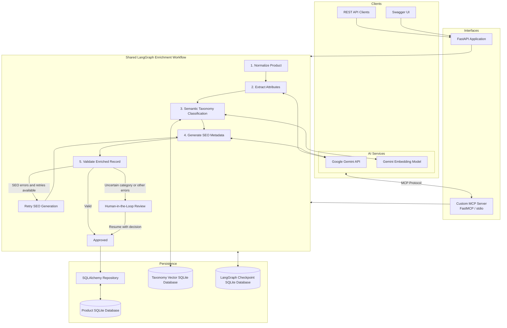

# AI-Powered Catalog Enrichment Pipeline

<p align="center">
  <strong>Transform unstructured product data into structured, categorized and SEO-ready catalog records using AI.</strong>
</p>

<p align="center">
  <a href="https://ai-catalog-enrichment-pipeline.onrender.com/docs">
    
  </a>
  <a href="https://ai-catalog-enrichment-pipeline.onrender.com/health">
    
  </a>
</p>

<p align="center">
  
  
  
  
  
</p>

## Introduction

An AI-powered product catalog enrichment system that transforms unstructured product data into structured, categorized and SEO-ready catalog records.

Built with **Python, FastAPI, Google Gemini, LangGraph, semantic taxonomy retrieval, SQLite and Model Context Protocol (MCP)**, the system automates product attribute extraction, category classification, SEO generation and validation, with human-in-the-loop review for uncertain or invalid records.

The project exposes its capabilities through both REST APIs and a custom MCP server, allowing traditional applications and AI assistants to interact with the same enrichment workflow.

---

# 🚀 LIVE DEMO — TRY IT YOURSELF

> **No installation required. No repository cloning required.**
>
> Open the interactive API documentation, submit a product and see the AI enrichment pipeline in action.

## 🌐 Live Application

| Resource | Link |
|---|---|
| **Live API** | [Open Application](https://ai-catalog-enrichment-pipeline.onrender.com) |
| **Interactive Swagger UI** | [TEST THE API HERE](https://ai-catalog-enrichment-pipeline.onrender.com/docs) |
| **Health Check** | [Check API Health](https://ai-catalog-enrichment-pipeline.onrender.com/health) |

## ⚡ Test Your First Product in 3 Steps

### STEP 1 — Open Swagger UI

👉 **[CLICK HERE TO OPEN THE LIVE API DOCUMENTATION](https://ai-catalog-enrichment-pipeline.onrender.com/docs)**

### STEP 2 — Submit a Product

1. Find and expand `POST /api/v1/enrich`.
2. Click **Try it out**.
3. Paste the sample JSON below.
4. Click **Execute**.

**Sample product input:**

```json
{
  "sku": "ROYAL-CANIN-001",
  "title": "Royal Canin German Shepherd Adult Dry Dog Food 3kg",
  "description": "Complete dry dog food for adult German Shepherd dogs, supporting digestive health and coat condition.",
  "brand": "Royal Canin",
  "category": "Pet Supplies",
  "attributes": {
    "pet_type": "Dog",
    "breed": "German Shepherd",
    "life_stage": "Adult",
    "weight": "3kg"
  }
}
```

### STEP 3 — Explore the AI-generated Result

The response includes:

- AI-extracted product attributes
- Semantic product category
- SEO-optimized title and description
- Validation results
- Workflow status (`approved` or `pending_review`)

## 🔍 Explore More API Capabilities

| Endpoint | What to test |
|---|---|
| `POST /api/v1/enrich` | Enrich a single product |
| `POST /api/v1/enrich/batch` | Enrich multiple products |
| `GET /api/v1/products` | View stored products |
| `GET /api/v1/products/{sku}` | Retrieve an enriched product |
| `POST /api/v1/products/{sku}/review` | Approve or reject a pending product |
| `GET /health` | Check API health |

**Testing tips:**
- Use a unique SKU for each new product.
- Try products from different categories, such as electronics, apparel, beauty and pet supplies.
- Products with uncertain classifications or validation failures may enter human review.
- The free hosting instance may take some time to wake up after inactivity.
- AI requests are subject to Gemini API quotas.

---


## Key Features

- **AI-powered attribute extraction:** Extracts product information such as brand, color, material, size, weight, pet type and life stage using Google Gemini.
- **Semantic product classification:** Uses Gemini embeddings and similarity-based retrieval to map products to relevant taxonomy categories.
- **Automated SEO generation:** Generates SEO-friendly product titles and descriptions grounded in extracted product information.
- **Workflow orchestration:** Uses LangGraph to organize enrichment into modular nodes with conditional routing and retry handling.
- **Human-in-the-loop review:** Routes uncertain classifications and validation failures to a review step, allowing approval or rejection before workflow completion.
- **Checkpointed workflows:** Persists LangGraph workflow state to SQLite to support resuming interrupted human-review workflows.
- **Batch processing:** Supports enrichment of multiple products through a single API request.
- **MCP integration:** Provides nine custom MCP tools for AI assistants and MCP-compatible clients.
- **Persistent product storage:** Stores original product inputs, enrichment results and workflow statuses using SQLAlchemy and SQLite.


## Architecture

The system uses a shared enrichment workflow. REST API requests and MCP tool calls both invoke the same LangGraph pipeline and repository layer.



### Architecture Components

| Component | Responsibility |
|---|---|
| FastAPI | REST endpoints, request handling and API documentation |
| Pydantic | Input validation and structured data contracts |
| LangGraph | Workflow orchestration, conditional routing, retries and human review |
| Google Gemini | Product attribute extraction and SEO generation |
| Gemini Embeddings | Semantic product-to-category matching |
| SQLite | Product storage, taxonomy vectors and workflow checkpoints |
| SQLAlchemy | Database access and repository operations |
| FastMCP | Exposes pipeline functionality as MCP tools |

### Enrichment Workflow

1. **Normalize:** Cleans and standardizes incoming product information.
2. **Extract:** Uses Gemini to extract relevant product attributes.
3. **Classify:** Retrieves the most relevant category using semantic similarity.
4. **Generate SEO:** Creates an SEO title and description.
5. **Validate:** Checks required fields, category classification and SEO constraints.
6. **Retry:** Retries SEO generation when applicable validation errors occur and retries remain.
7. **Human review:** Routes uncertain categories and other unresolved validation errors for human approval or rejection.
8. **Persist:** Saves the enrichment result and workflow status.

The workflow uses configurable retry limits and checkpointing so a pending human-review workflow can be resumed with its original state.

## Technology Stack

- **Language:** Python 3.12
- **Backend:** FastAPI, Uvicorn
- **AI / LLM:** Google Gemini API
- **Workflow orchestration:** LangGraph
- **Embeddings:** Gemini Embedding Model
- **MCP:** FastMCP
- **Validation:** Pydantic
- **Database:** SQLite
- **Database access:** SQLAlchemy
- **Testing:** Pytest, HTTPX

## Project Structure

```text
ai-catalog-enrichment-pipeline/
│
├── app/
│   ├── core/
│   │   └── config.py
│   │
│   ├── db/
│   │   ├── database.py
│   │   └── repository.py
│   │
│   ├── services/
│   │   ├── extractor.py
│   │   ├── llm.py
│   │   ├── taxonomy.py
│   │   └── validator.py
│   │
│   ├── workflows/
│   │   └── pipeline.py
│   │
│   ├── main.py
│   ├── mcp_server.py
│   └── schemas.py
│
├── tests/
│   ├── test_api.py
│   └── test_pipeline.py
│
├── data/
│   └── (local taxonomy and checkpoint databases)
│
├── .env.example
├── .gitignore
├── requirements.txt
└── README.md
```

## Getting Started

### Prerequisites

- Python 3.12 or later
- Git
- Google Gemini API key for live AI-powered enrichment

### 1. Clone the Repository

```bash
git clone https://github.com/shreya-saini/ai-catalog-enrichment-pipeline.git

cd ai-catalog-enrichment-pipeline
```

### 2. Create a Virtual Environment

**Windows PowerShell:**

```powershell
python -m venv venv
venv\Scripts\Activate.ps1
```

**macOS / Linux:**

```bash
python -m venv venv
source venv/bin/activate
```

### 3. Install Dependencies

```bash
pip install -r requirements.txt
```

### 4. Configure Environment Variables

Create a `.env` file in the project root.

```env
APP_NAME=AI Catalog Enrichment Pipeline

DATABASE_URL=sqlite:///./catalog.db

LLM_MODE=gemini

GEMINI_API_KEY=your_gemini_api_key

GEMINI_MODEL=gemini-2.5-flash

MAX_RETRIES=2
```

Get a Gemini API key from [Google AI Studio](https://aistudio.google.com/).

The configured Gemini model must be available to your API key and account.

**Important:** Never commit your `.env` file or expose your API key in source code or public repositories.

### 5. Run the API

```bash
uvicorn app.main:app --reload
```

The API will be available at:

- API base URL: http://127.0.0.1:8000
- Swagger documentation: http://127.0.0.1:8000/docs
- Health check: http://127.0.0.1:8000/health

## REST API Documentation

### Available Endpoints

| Method | Endpoint | Description |
|---|---|---|
| GET | `/health` | Health check |
| POST | `/api/v1/enrich` | Enrich a single product |
| POST | `/api/v1/enrich/batch` | Enrich multiple products |
| GET | `/api/v1/products` | List stored products |
| GET | `/api/v1/products/{sku}` | Retrieve a product |
| POST | `/api/v1/products/{sku}/review` | Approve or reject a pending product |

### 1. Health Check

```http
GET /health
```

Example response:

```json
{
  "status": "ok"
}
```

### 2. Enrich a Product

```http
POST /api/v1/enrich
```

Request:

```json
{
  "sku": "PET-101",
  "title": "Royal Canin German Shepherd Adult Dry Dog Food 3kg",
  "description": "Complete dry food for adult German Shepherd dogs.",
  "brand": "Royal Canin",
  "attributes": {
    "weight": "3kg"
  }
}
```

Example response structure:

```json
{
  "sku": "PET-101",
  "normalized_title": "Royal Canin German Shepherd Adult Dry Dog Food 3kg",
  "brand": "Royal Canin",
  "category": "Pet Supplies",
  "attributes": {
    "brand": "Royal Canin",
    "breed": "German Shepherd",
    "life_stage": "Adult",
    "pet_type": "Dog",
    "weight": "3kg"
  },
  "seo_title": "Royal Canin German Shepherd Adult Dog Food",
  "seo_description": "Explore Royal Canin adult German Shepherd dog food.",
  "status": "approved",
  "validation_errors": [],
  "retries": 0
}
```

*Example response values are illustrative; actual generated attributes and SEO content depend on the model response.*

### 3. Batch Enrichment

```http
POST /api/v1/enrich/batch
```

Example request:

```json
[
  {
    "sku": "PET-101",
    "title": "Royal Canin Adult German Shepherd Dog Food",
    "description": "Dry food for adult German Shepherd dogs.",
    "brand": "Royal Canin"
  },
  {
    "sku": "APP-101",
    "title": "Blue Cotton Oversized T-Shirt",
    "description": "Comfortable cotton oversized t-shirt.",
    "brand": "Example Brand"
  }
]
```

Maximum batch size: 100 products.

### 4. List Products

```http
GET /api/v1/products
```

Returns stored product SKUs, workflow statuses and creation dates.

### 5. Retrieve a Product

```http
GET /api/v1/products/PET-101
```

Returns the original input and the enriched product record.

### 6. Human Review

Products requiring human confirmation are stored with the `pending_review` status.

Approve or reject a product:

```http
POST /api/v1/products/PET-101/review
```

Request:

```json
{
  "approved": true,
  "reviewer_notes": "Category and product attributes verified."
}
```

A review decision resumes the corresponding LangGraph workflow using its saved checkpoint.

## Model Context Protocol (MCP) Integration

The project includes a custom MCP server implemented using FastMCP.

It exposes the catalog enrichment pipeline as structured tools that can be called by MCP-compatible AI assistants and applications.

Both the REST API and MCP server use the same underlying workflow and repository functionality.

### Available MCP Tools

| Tool | Description |
|---|---|
| `enrich_product` | Run the complete enrichment workflow for one product |
| `enrich_products_batch` | Enrich multiple products in one operation |
| `get_product` | Retrieve a product and its enrichment result |
| `list_products` | List stored products and statuses |
| `get_review_queue` | Retrieve products awaiting human review |
| `review_product` | Approve or reject a pending product |
| `get_taxonomy` | Retrieve available taxonomy categories |
| `classify_product` | Classify a product using semantic taxonomy retrieval |
| `validate_product` | Validate an enriched product record |

### Run the MCP Server

Activate your virtual environment and configure the `.env` file.

Run:

```bash
python -m app.mcp_server
```

The server currently uses **stdio transport**, making it suitable for local MCP client integration.

### Example MCP Client Configuration

For an MCP client that supports stdio server configuration, use the following as a template:

```json
{
  "mcpServers": {
    "catalog-enrichment": {
      "command": "python",
      "args": [
        "-m",
        "app.mcp_server"
      ],
      "cwd": "ABSOLUTE_PATH_TO_PROJECT",
      "env": {
        "GEMINI_API_KEY": "YOUR_GEMINI_API_KEY",
        "GEMINI_MODEL": "YOUR_CONFIGURED_GEMINI_MODEL",
        "LLM_MODE": "gemini",
        "DATABASE_URL": "sqlite:///./catalog.db"
      }
    }
  }
}
```

Replace the project path with your local project directory. Use your MCP client's supported environment configuration and keep API credentials private.

The current MCP implementation is a local stdio server; remote MCP transport and authentication are future extensions.

## Database and Persistence

The project currently uses SQLite with SQLAlchemy.

Three separate local SQLite databases are used:

- **Product database:** Stores product inputs, enrichment outputs and statuses.
- **Taxonomy vector database:** Stores taxonomy embeddings used for semantic category retrieval.
- **LangGraph checkpoint database:** Stores workflow state to support human-review resumption.

The local database files are generated at runtime and are excluded from Git.

For deployment, use persistent storage or migrate the databases to suitable managed storage. The current SQLite setup should not be assumed to provide durable persistence on an ephemeral hosting filesystem.

## Testing

The project includes automated tests for API health and core enrichment workflow behavior.

Run the test suite:

```bash
python -m pytest tests/ -v
```

Current test coverage includes:

- API health endpoint.
- Successful apparel product enrichment.
- Unknown-category handling and human-review routing.

The pipeline tests use mocked AI dependencies to make them deterministic and avoid Gemini API calls.

**Latest local test result:**

```text
3 passed
```

## Deployment

The application can be deployed as a FastAPI web service on a hosting platform that supports Python applications.

### Deployment Configuration

**Build command:**

```bash
pip install -r requirements.txt
```

**Start command:**

```bash
uvicorn app.main:app --host 0.0.0.0 --port $PORT
```

Configure these environment variables in the hosting provider:

```env
APP_NAME=AI Catalog Enrichment Pipeline
LLM_MODE=gemini
GEMINI_API_KEY=your_secret_api_key
GEMINI_MODEL=your_available_gemini_model
MAX_RETRIES=2
DATABASE_URL=your_persistent_database_url
```

Use the provider's secret/environment-variable settings for credentials.

### Free-Tier Considerations

- Free hosting plans and API quotas can change.
- Some free application hosts sleep when idle, resulting in cold starts.
- Ephemeral filesystems can lose SQLite databases after restarts or redeployments.
- Gemini free-tier quotas and model availability are subject to Google's current terms.
- Public API deployments should have authentication, rate limiting and request-size controls before being shared widely.

For a reliable public demo, configure durable storage for product records, taxonomy vectors and workflow checkpoints. A PostgreSQL migration alone does not automatically migrate the separate taxonomy and checkpoint SQLite databases.

## Security Considerations

- API keys are loaded through environment variables.
- `.env` and local database files are excluded from version control.
- Public deployments should implement authentication and rate limiting.
- Batch endpoints should have request-size and usage limits.
- Human-review endpoints should be protected against unauthorized decisions.
- Do not expose a public MCP server without appropriate transport security and authentication.

## Future Improvements

- Remote MCP deployment using Streamable HTTP.
- Authentication and authorization for REST and MCP interfaces.
- PostgreSQL migration and Alembic database migrations.
- Confidence scoring and improved taxonomy evaluation.
- Category-specific product schemas and validation.
- CSV catalog ingestion and asynchronous bulk processing.
- Redis-backed queues for large enrichment jobs.
- Observability, structured logging and workflow metrics.
- Expanded unit, integration and end-to-end testing.
- Deployment automation using CI/CD.

## Author

**Shreya Saini**

Software Engineer | Full Stack Development | Backend Systems | Generative AI

GitHub: https://github.com/shreya-saini

---

*This project demonstrates an end-to-end AI-powered catalog enrichment workflow with REST and MCP interfaces, semantic retrieval, stateful orchestration and human-in-the-loop processing.*